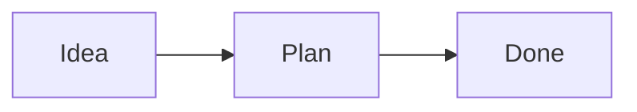

<p align="center">
  <picture>
    <source media="(prefers-color-scheme: dark)" srcset="assets/logo/starlight.svg">
    
  </picture>
</p>

# Starlight

**A private AI assistant that runs entirely on your own PC.**

Starlight uses a language model on your own graphics card, with no account, no
subscription and no token limits. It remembers what you tell it and can browse the web.
It can check your servers, read the screen, use mouse and keyboard, write and test code,
and answer you on WhatsApp. It will ask you before it does anything risky. And one key press stops it.

- [What it can do](#what-it-can-do)
- [What you need](#what-you-need)
- [Installation](#installation)
- [Using Starlight](#using-starlight)
- [Optional extras](#optional-extras)
- [Safety and privacy](#safety-and-privacy)
- [Troubleshooting](#troubleshooting)
- [Command reference](#command-reference)
- [For developers](#for-developers)

---

## What it can do

| Feature | What it does |
| --- | --- |
| **Chat in its own window or the terminal** | A clean chat in Starlight's own window (the default on Windows; or in the browser) or a colored terminal chat. Both stream answers and ask before risky actions. |
| **Chat with a local model** | Runs a model such as Qwen2.5-14B on your GPU. Long conversations are summarized, not cut off. |
| **Remember** | Keeps what it learns as plain text files in the `memory` folder. You can read, edit or delete them. Knows your name, language and home town from your profile, tells you what it knows about you, and tidies up memories that say the same thing (asks first). Something that only holds for a while ("my sister visits until Friday") is forgotten after that date. The **Memory** page has a **Timeline** (by month) and **People & places**; ⋯ → *Forget what it learned here* on a conversation removes what was learned only there. |
| **Use the web** | Searches, reads pages and logs in to your accounts. It makes at most 10 requests per second, with a short pause between pages of the same site. A page you ask for is read like a browser would; crawling several pages (research, page watches) respects robots.txt. |
| **Check your servers** | Pings and checks any server, runs commands over SSH, and alerts you when one of yours goes down. |
| **Scan your network** | On hosts you own or are authorized to test: open ports, services, TLS certs, HTTP headers, DNS. Asks first; recon only, never attacks. |
| **Security tools (Absolution)** | A cockpit for security programs you already have — scanners, recon, cloud and code checks, capture and memory analysis, reverse engineering (Nmap, Nikto, Nuclei, Trivy, Semgrep, tshark, Volatility, Ghidra and more). It asks before every run and shows the exact command; network targets must be authorized first; it never installs anything, and it does not drive offensive tooling. Off by default. |
| **Look up vulnerabilities** | Checks a service or product against the public CVE database (NVD). Pairs with a scan. Free, no key. |
| **Check certificates** | Reads your servers' TLS certificates and warns when one is about to expire. |
| **Check passwords** | Tells you if a password is in known breaches — the password never leaves your PC (only a short hash prefix is sent). |
| **Game mode** | Start a game and Starlight's model steps aside: the launcher stops the model server (or unloads the model in LM Studio) so the game gets the whole graphics card, and brings it back when the game closes. A game is anything from Steam, Epic, GOG or Xbox game folders, or a program you name ("count minecraft.exe as a game"). Meanwhile Starlight answers with a short note instead of an error; **Resume now** in the Starlight window or the web chat, or `starlight model resume`, brings it back early. Turn it off with `auto: false` in `config\modules\game.yaml`. |
| **Check your PC** | CPU, memory, disk space, battery, uptime and running programs. "What fills my disk?" lists the biggest folders and files. Shows which programs start when you log in and turns one off or on again (yours only; asks first). Can close a program, and lock, sleep, shut down or restart the PC, now or in a few minutes (asks first, except locking; the kill switch also cancels a planned shutdown). |
| **Focus mode** | "Focus for 90 minutes" — holds back reminders, alerts and messages while you work, then gives you one summary. Urgent things (an event about to start, a server down, an unknown device on your WiFi) still come through. |
| **Watch pages and prices** | "Tell me when this kettle costs less than 50 €", "… when 'sold out' is gone", "… when this page changes" — checks the page every so often (at least 5 minutes apart, robots.txt respected) and tells you on every channel. |
| **Use the clipboard** | Reads what you copied and copies things for you. With `history: true` in `config\modules\clipboard.yaml` it remembers the last 30 things you copied (in memory only, never on disk; anything that looks like a password is skipped), so "what did I copy before?" and "copy the third one again" work. |
| **Trains** | "When is the next train to Berlin?", "Verbindung morgen um 8 Uhr nach München" — Deutsche Bahn connections with delays, platforms, changes and cancellations, and the departure board of any station (trains, S-/U-Bahn, buses, trams). Free, no account or API key (db.transport.rest). Set `home_station` in `config\modules\trains.yaml` to leave out where you start. |
| **Weather** | Current weather and a short forecast for any place, plus pollen (birch, grass, …), air quality and UV for the next days — free, no account or API key. |
| **News** | Headlines and topic search from free news feeds (RSS). No account or API key. |
| **Prices** | Stock, currency and crypto prices from free sources. No API key. |
| **Find files** | Searches your PC for files by name or by what's inside them. Read-only. |
| **Reminders** | "Remind me in 2 hours …", "every weekday at 7:30 …", "every Monday at 9:00 …", "every month on the 1st …" — reminders that come back to you on the desktop, in the web chat and on WhatsApp, even after a restart. Or one that waits for a program: "when I open Excel, remind me to send the report". |
| **To-do lists** | "Add 'file taxes' for Friday, high priority" — lists, due dates and priorities; shows what's due and overdue. Tasks written in your notes count too (`- [ ] Call Tom due: friday priority: high`): they show up with their note, and "done: call Tom" ticks them in the note. A date you type in words becomes a date like 2026-11-06 when Starlight or the Notes page saves. German works too (`fällig: Freitag`, `priorität: hoch`, `wiederholen: jeden Montag`). |
| **Calendar** | Add events, see your agenda and free time, get an alert before something starts. Subscribe to your Google/Outlook/Nextcloud calendar's iCal link (read-only). Ten minutes before a meeting it sends what you have on it: your notes, mail and documents that mention it (`prepare_minutes` in `config\modules\calendar.yaml`; 0 turns it off). |
| **Daily briefing** | "How does my day look?" — events, to-dos, reminders, weather, headlines, new mail and alerts in one short message. "Read me my briefing" says it out loud on the PC's speakers (with the voice installed). |
| **Automations** | "Send me the briefing every weekday at 7:30", "when the NAS goes down, tell me" — rules that run on a schedule or when something happens. Anything that normally asks first runs only if you approved it for that rule: approving a rule's own step covers exactly that step; for the model to use a tool in an "ask" step, allow it with `automations.allow`. The **Automations** page in the web chat builds rules with *When* (a schedule or an event), *If* (a condition on the event) and *Then* (steps), checks them and shows what they may run without asking; ready-made ones include the briefing read aloud, overnight mail, a weekly PC check-up and a low-battery warning. A condition can combine several with and, or, not and brackets (also und, oder, nicht), for example "when a server goes down, if `server is nas or server is router`, tell me", or after a step `count > 0 and items has milk`; words with "and" or "or" in them go in quotes (`subject has "rock and roll"`). A weekly schedule names its day ("every Monday at 9:00"). A saved rule whose schedule Starlight does not understand (one made as "every week at 9:00" before it asked for the day, or a typo in `automations.yaml`) is kept but does not run until it gets a new one: "reschedule review to every Monday at 9:00" (`automations.reschedule`); the Automations page marks it. Under each rule the page says when it last ran and how it went (done, failed with the reason, waiting for your OK, skipped); **History** opens its last ten runs. **Use** on a ready-made rule fills its messages in German on a German page. |
| **Notices what happens on the PC** | A new file in a folder you watch ("watch my Downloads folder"), a USB stick or drive plugged in or out, the battery running low, a program starting, you leaving the PC and coming back — automations can react to each. Coming back after 10 minutes or more brings one message with what came in meanwhile. |
| **Approval queue** | What Starlight prepared for you — a drafted reply, an automation step it may not take by itself — waits on the **Activity** page (and "N waiting" in the chat header). **Approve** runs exactly what is shown (if that fails, say because the mail server is away, it waits again with the reason); **Dismiss** drops it. |
| **PC check-up** | "How healthy is my PC?" — disk space, memory, time since the last restart, programs that start at login, program updates, backups and certificates in one report. Weekly as an automation. |
| **Exact maths** | Calculations, unit conversion (km/mi, °C/°F, GB/MB, …) and date maths ("days until 24.12.") worked out exactly, not guessed. |
| **Translate** | Translates text with your own model — offline, nothing leaves the PC. |
| **Desktop notifications** | Pops a notification on your screen to get your attention. |
| **Email** | Reads your inbox and sends mail from your own account. Shows what's unread without marking it read, sorts it into important / can wait / probably spam, drafts replies for you to check, and replies in the same thread (sending runs without asking out of the box; remove `mail.send` and `mail.reply` from `permissions: auto_approve:` to be asked). Can tell you right away when someone you choose writes. The mail server's certificate is checked; for a server with a self-signed certificate set `verify_certificate: false` in `config\modules\mail.yaml`. "What came in overnight?" sums up newsletters in one line each, sorts the rest, and drafts replies to personal mail that wait in the approval queue; nothing is sent until you approve. "Find mail about the budget" searches the whole mailbox. |
| **PDFs** | Reads text from PDF files and makes simple PDFs from text. |
| **Open programs** | "Open Spotify", "open my budget sheet", "bring Outlook to the front" — starts any installed program, opens files and links, and arranges or closes windows. "Save this window layout as work" remembers where your windows are and puts them back later. On Windows it finds, installs and updates programs with winget ("which programs have updates?"; installing and updating ask first). |
| **Music and volume** | Play/pause, next/previous track and volume, like the media keys. |
| **Your own commands** | Name your own scripts once ("backup-photos", "restart the game server") and run them by name; they ask first unless you say otherwise. Starlight can also run any command line (PowerShell on Windows) — it shows you the exact command and asks every time, and never from the phone. |
| **Word and Excel** | Reads .docx and .xlsx files and makes new ones (letters, lists, tables). |
| **Developer tools** | Git status/log/diff/commit, Docker containers and their logs, and which program uses which network port. Changes ask first. "Review my changes" has your model read the git diff (or what is staged) and point out bugs, risks and unclear code. |
| **Research** | "Find out whether …" — searches, reads several pages and writes a short report with numbered sources you can check. |
| **Your own knowledge base** | "What does my rental contract say about pets?" — answers from folders you choose (text, Word, Excel, PDF), naming the file and page; in the web chat a source opens the PDF at that page. With Tesseract installed (free; on Windows the UB Mannheim installer), the text in photos and scanned PDFs is found too (`ocr: false` in `config/modules/docs.yaml` turns it off). Everything stays on your PC. |
| **Expenses** | "I spent 23,40 € on groceries" — notes what you spend by day and category; "how much did I spend this month?" sums it up by category and against a budget (`monthly_budget` in `config\modules\expenses.yaml`). Reads a receipt (photo, scan or PDF) with your model and notes it. Exports a month as a CSV file for Excel. |
| **Birthdays** | "Anna's birthday is on 12.3." — tells you a few days before (and on the day), with how old they turn when you gave the year. |
| **Habits** | "Track 'walk' every day", "done walk" — your streak and the last two weeks at a glance; daily or weekly. |
| **Recipes** | Saves recipes as plain files in `Documents\Starlight\Recipes`, finds them by ingredient, scales them ("pancakes for 6") and makes one shopping list from several. |
| **Trips** | "Kiel from 20.12. to 23.12." — a countdown, and a packing list from the trip's length and, once it is close, the weather forecast there. |
| **Podcasts** | Subscribe to a podcast's feed, see its new episodes and play one. No account. |
| **Watch log files** | "Tell me when 'error' shows up in this log" — looks at the new lines every 30 seconds and tells you which matched (asks before it starts watching a file). |
| **Journal** | "Journal: a long hike today, tired but happy" — one file a day in `Documents\Starlight\Journal`; read a day back or search it. "My weekly review" writes up the last seven days (with your to-dos and next week's calendar): what happened, what got done, what is open, what to focus on. Schedule it with an automation ("every Sunday at 18:00"). |
| **Notes** | Quick notes as plain files ("note: …", "add eggs to my shopping note"), searchable and part of your knowledge base. |
| **Boards** | Cards and arrows on an endless surface: "what's on my project board?", "add the article https://… to my reading board", "put 'call the bank' under the card about money". Boards are `.canvas` files in `Documents\Starlight\Boards` (the open JSON Canvas format, so Obsidian opens them too); every change keeps the earlier version. |
| **Flashcards** | "Quiz me on Spanish": write `Question::Answer` lines in a note tagged `#flashcards` (`#lernkarten` works too), and Starlight asks you one card at a time. A card you know comes back later and later; one you don't comes back the same day. "Make a card: capital of Peru, Lima" adds one. Study them on the Notes page too. |
| **YouTube summaries** | Summarizes a video or answers a question about it from its captions, with the times it was said. |
| **Talk to it** | Speak instead of typing and hear the answers — the microphone and the speaker in the web chat (on your phone too), `/talk` in the terminal. **Conversation** (the speech bubble next to the microphone) in the web chat: just talk; when you pause, it is sent, the answer is read out, and it listens again — speaking while an answer is read out stops it. **"Hey Starlight"**: with it switched on (Settings → Voice, or "listen for Hey Starlight"), say the phrase near the PC and then what you want; the answer comes out of the PC's speakers. Only short bits of speech are written down, on the PC, to look for the phrase. **Settings → Voice** chooses the voice for each language and installs more (nine German and seven English voices, from Piper). Speech recognition (whisper.cpp) and the voices (Piper) run on your PC. Install with `Starlight.exe --voice`. |
| **Summarize recordings** | "Summarize meeting.m4a" — transcribes a meeting, voice memo or lecture on your PC and writes the main points, decisions and to-dos; both are saved in `Documents\Starlight\Recordings`. Any length (it works in five-minute pieces). .wav works as it is; mp3, m4a, ogg or a video need ffmpeg (`winget install ffmpeg`). |
| **Smart home** | "Turn off the living room lights", "is the front door locked?" — through your Home Assistant. Lights, plugs and scenes switch at once; locks, alarms, doors and heating ask first. |
| **Your home network** | Which devices are on your WiFi (with names you give them), and a warning when an unknown one joins. Only ever looks at your own network. With `watch: true` in `config\modules\lan.yaml`, automations can react when a device you know comes home or leaves (`lan.device_joined`, `lan.device_left`). |
| **Backups** | Versioned backups of folders you choose (e.g. to an external drive), checked with checksums; restoring asks first and never overwrites without your say. Schedule them with an automation. |
| **Use your desktop** | Reads the screen, then clicks and types for you, with a red banner on screen while it does. |
| **Save files** | Saves letters, notes, tables (CSV) and web pages it makes for you in `Documents\Starlight`. |
| **Write code** | Writes small programs, tests them in a sandbox and fixes them until the tests pass. |
| **Learn skills** | Turns tasks that worked into reusable skills, but only after you approve them. **Export** one on the Memory page (or `starlight skills export NAME`) to give it to another Starlight; an imported skill comes in as a draft for you to read and approve. |
| **Manage access from chat** | Add servers, logins and API keys, and set what runs without asking — all by typing, no files to edit. |
| **Answer on WhatsApp** | Lets you send tasks from your phone and stop everything with `/kill`. |
| **Show statistics** | Shows tasks, errors, model speed and GPU use in a separate viewer in your browser. **Models compared** puts every model you used side by side: answers, tokens per second, seconds per answer, how many of its tool calls failed, and its last tool-use exam. |
| **In German** | The web chat and its pages are in German when your browser is (or choose under **Settings → Language**), and the launcher window when Windows is (or set `STARLIGHT_LANG=de`). Your conversation is never changed: the model answers in the language you write in. |
| **For keyboards and screen readers** | Every button and field has a name a screen reader can say, the conversation is announced as it arrives, Tab shows a clear focus ring, a "Skip to the message box" link comes first, and the pages follow the system's high-contrast and reduced-motion settings. |

## What you need

| Requirement | Details |
| --- | --- |
| **Computer** | Windows 11, 64-bit (Windows 10 should work but is untested). Linux works too, see [Linux](#linux). |
| **Graphics card** | AMD, NVIDIA or Intel, with an up-to-date driver. The default model needs **16 GB of video memory** (e.g. an RX 9060 XT 16 GB). With less, choose a [smaller model](#a-different-model). Without one it runs on the CPU, but slowly. |
| **Disk space** | About **12 GB** free: ~2 GB for the programs and ~9 GB for the model. |
| **Internet** | For the first setup and for web features. |

Nothing has to be installed beforehand, and no administrator rights are needed.

---

## Installation

### 1. Download

Open the [Releases page](https://github.com/Paul44ur/Starlight-Projekt-V2/releases) and
download `Starlight-<version>-windows.zip`. It contains the Starlight folder with
`Starlight.exe` already inside.

> [!NOTE]
> **No release yet?** Download the code with the green **Code** button, then
> **Download ZIP**. Then get `Starlight.exe`:
> 1. Open [Actions → Launcher](https://github.com/Paul44ur/Starlight-Projekt-V2/actions/workflows/launcher.yml).
> 2. Open the newest green run.
> 3. Download the **Starlight-windows** file at the bottom.
> 4. Unzip it.

### 2. Unpack

Unpack the zip into a folder of your own, for example `C:\Starlight`.

- **Avoid `C:\Program Files`.** Starlight needs to write inside its folder, and Program
  Files needs administrator rights.
- **Avoid OneDrive folders such as Desktop or Documents.** OneDrive would try to upload
  the 9 GB model.

If you downloaded the two files separately, put `Starlight.exe` into the unpacked folder,
next to `pyproject.toml`.

### 3. Start Starlight.exe

Double-click `Starlight.exe`.

Windows may show **"Windows protected your PC"**, because the program isn't signed yet.
Click **More info**, then **Run anyway**. You only need to do this once.

### 4. Choose and let it set everything up

Double-clicking opens the **Starlight window** (no black console window). On the first
start it shows a welcome page:

- **Model.** Three ready-made choices with what each needs. Starlight reads your graphics
  card and marks the one that fits it ("Recommended for your PC"), with the download size
  next to each. Models you already have are marked "Downloaded".
- **Options.** Run the model on the graphics card, speech (talk to it and hear answers),
  the statistics page - and, on Windows, Tesseract for reading text on the screen.
- A line at the bottom says how much space it needs and how much the drive has.

Press **Install and start**. A progress page shows each step, the download with speed and
time left, and a "Show details" box with the output of the installers. How long it takes
depends on your internet connection, mostly for the model.
- Starlight's packages, the model server and the model go into the Starlight folder
  (`.venv`, `tools`, `models`). Python and the Chromium browser go into your user
  profile, where uv and Playwright keep them (`%APPDATA%\uv\python` and
  `%LOCALAPPDATA%\ms-playwright`). Nothing needs administrator rights, except the
  optional Tesseract installer, which asks once.
- If the download is interrupted, start `Starlight.exe` again. It continues where it
  stopped.
- Every download that publishes a checksum is checked against it.
- Your choices are saved in `config\launcher.json`.

### 5. Chat

When the model is loaded, the window changes to **"Starlight is running"** and the chat
opens in your web browser (http://127.0.0.1:8700). Type in the browser window and press
Send. Actions that change something show Approve / Deny buttons.

The window stays as the control panel. It shows live whether the model, the chat, the
statistics page and the kill switch are up, and has buttons for **Open chat**,
**Statistics**, **Stop everything** (the kill switch; the button becomes **Resume**),
**Restart model server** (**Resume now** while game mode has paused the model),
**Check everything** (the same as `starlight doctor`),
**Open logs folder** and **Settings** (change the model or options; it restarts
Starlight). If something fails, the window says what and, for the common problems (a model
too big for the graphics card, a full drive, no internet, a busy port, a blocked file), what
to try; the technical details are one click away. It offers **Try again**, **Settings**
(for example a smaller model), **Open logs folder** and **Copy details**. The model shows by
its name; while the kill switch is on, **Resume** is the highlighted button. **Enter**
presses the highlighted button and **Esc** leaves Settings. There is a light and a dark look,
following Windows.

**The chat opens in Starlight's own window**, not in your browser: a window with Starlight's
name and star in the taskbar, with every page of the chat in it (Chat, Notes, Memory,
Activity, Automations, Settings). It uses WebView2, the part of Microsoft Edge that Windows
11 already has. Links to other websites open in your browser; printing or exporting a
conversation opens a second Starlight window; a download asks where to save. The window
remembers its size, your theme and your language. When an answer is ready (or Starlight
waits for your OK) and the window is in the background, its title gets a dot and its taskbar
button lights up; in a browser, a notification shows if you allowed it. Switch this off in
Settings, under **When an answer is ready**. Closing it leaves Starlight running: **Open
chat** brings it back. Prefer the
browser? Untick **Open the chat in Starlight's own window** in Settings, or start
`Starlight.exe --browser`. If the window cannot open (no WebView2), the browser opens the
chat and the Starlight window says why.

**A tray icon keeps Starlight next to the clock.** While Starlight runs, its star sits by the
clock (maybe under the little arrow). Closing the Starlight launcher window then only hides it;
Starlight keeps running, and the first time a note says so. Click the icon to open the chat.
Right-click it for the menu: **Open Starlight**, **Show launcher window** (while it is
hidden), **Kill switch** (it says **Resume** while the kill switch is on) and **Quit
Starlight**. **Quit Starlight** is the way to really stop everything (it asks first, as the
**Stop everything** button does). When an answer is ready while Starlight's chat window is in
the background, a Windows notification shows next to the clock; click it to open the chat. Windows
may hide it while Focus assist is on. Don't want the icon? Untick **Keep Starlight next to the
clock when its window is closed** in Settings (`"tray": false` in `launcher.json`): closing the
launcher window then stops Starlight, as before. The setup and error pages always stop
Starlight when you close them.

Prefer the keyboard? Start `Starlight.exe --terminal` for a colored terminal chat in the
window instead.

That's it. **Next time, just double-click `Starlight.exe` again.** It skips the
downloads and goes straight to starting. **Quit Starlight** (in the tray icon's menu, or
the button in the window) stops everything (the model server, the chat and the viewer); without
the tray icon, closing the Starlight window does. The emergency stop is
**Ctrl+Alt+J** or moving the mouse into a screen corner.

The window is only the default when you start `Starlight.exe` plainly. Any option that
is meant for scripts or a terminal (`--yes`, `--ask`, `--terminal`, `--both`,
`--setup-only`, `--update`) uses the text version, which has colors, a progress bar with
speed and time left, and a single "loading the model ..." line. Use `--no-gui` to get the
text version always, or `--gui` to force the window.

### Options

Run `Starlight.exe --help` in a terminal to see every option. The most useful ones:

| Option | What it does |
| --- | --- |
| `--model qwen7b` | Use a ready-made model choice instead of the default (see [A different model](#a-different-model)). |
| `--no-think` | Models that think before they answer (Qwen3, gpt-oss) answer at once: quicker, a little less careful. |
| `--lmstudio-model <name>` | Use LM Studio, with this model loaded and used instead of whichever is loaded. |
| `--model-url <link>` | Use another model (a direct download link to a `.gguf` file). |
| `--context 16384` | A smaller context window: uses less video memory. `--context 0` (*Auto* in the window) reads the model file and your graphics card and uses as much as fits. |
| `--style precise` | How freely the model words its answers: `precise` (facts and tools), `balanced` (the usual) or `creative` (stories, ideas). *Answers* in the window. |
| `--ollama-model qwen3:14b` | Use a model in [Ollama](https://ollama.com) instead of downloading one (`"ollama_url"` in `launcher.json` if it is not on this PC). |
| `--remote-url http://192.168.1.20:8080/v1` | Use a model server on another PC in your network (llama-server, LM Studio, vLLM … anything OpenAI-compatible); `"remote_model"` names its model if it needs one. |
| `--variant cpu` | Run without a graphics card (slow). |
| `--terminal` | Chat in the terminal instead of opening the browser. |
| `--browser` | Open the chat in the browser, not in Starlight's own window (`"app_window": false` in `launcher.json` keeps it). |
| `--no-gui` | Don't open the Starlight window; use the text version. (`--gui` forces the window.) |
| `--both` | Open the browser chat **and** a terminal chat together — both talk to the same Starlight (one conversation, one kill switch). |
| `--voice` | Also install speech: talk to Starlight and hear its answers (about 0.6 GB, Windows; `"voice": true` in `launcher.json` keeps it). |
| `--no-viewer` | Don't start the statistics viewer. |
| `--update` | Download the newest uv and llama.cpp again (after copying your settings and data to `backups`). |
| `--rollback` | Go back to the uv and llama.cpp from before the last `--update` (and, if you say yes, your settings and data). |
| `--setup-only` | Download and set up, then exit without starting. |
| `--open starlight://note/Plan` | Open a note: in the running Starlight, or start Starlight with it (Windows runs this for you when you click such a link). |

To use options every time, put them into `config\launcher.json`, for example:

```json
{ "context": 16384, "viewer": false }
```

`"models_dir": "D:\\Models"` keeps the models in a folder of your own (another drive, or
one LM Studio shares).

**In the window.** *Find more models on Hugging Face …* under the list searches Hugging
Face for GGUF models and shows each one's files with their size (and which fit your
graphics card); *Use this model* makes it your own model. While a model downloads,
**Pause download** stops it and **Resume download** goes on where it stopped. On Windows,
*Start Starlight when I log in to Windows* adds it to your account's start list. When the
model is ready while the window is in the background, its taskbar button blinks. The
status page shows its main buttons large (**Open chat**, **Statistics**, **Stop
everything**); under **Tools** it also has **Speed test** (tokens per second), **Tool-use
exam** (does this model use Starlight's tools well?) and **Disk space** (what each model and
folder takes; unused models can be removed there).

**On the Settings page of the chat.** The **Model** card shows the model in use and lets you
pick another one that is already there: a `.gguf` file in the models folder, or a model that
LM Studio, Ollama or your other model server reports. You can also pick the context size. This
works at the PC only; from your phone the card only shows the model. **Save** writes your choice
to `config\launcher.json` (the earlier file is kept in `config\history`). It applies after
Starlight restarts: while the Starlight window is running, **Restart Starlight** there does
that (it stops the chat for about a minute, and asks first if an answer is being written).
Downloading new models, changing the kind of model server and everything else stay in the
Starlight window under **Settings**.

#### A different model

Thirty models are ready to pick in the setup window, with `--model <name>`, or with
`"model": "<name>"` in `config\launcher.json`. Each is downloaded the first time it is used.
The setup window recommends one for your graphics card and folds away those too big for it
("Also show ..." brings them back). Tags next to each name tell them apart: *thinks first*,
*quick*, *code*, *tools*, *languages*, *uncensored*. Up and Down move between models. A model
whose download link no longer works is flagged before you pick it, and a downloaded model you
are not using has a *Remove* link to free its space.

For graphics cards with up to 16 GB:

| Name | Model | Download | Video memory |
| --- | --- | --- | --- |
| `qwen14b-uncensored` | Qwen2.5-14B Instruct, uncensored (the default) | 9 GB | about 10 GB |
| `qwen14b` | Qwen2.5-14B Instruct, the original: more careful, cleaner turn endings | 9 GB | about 10 GB |
| `qwen3-14b` | Qwen3-14B: thinks before it answers, better at hard problems, slower to reply | 9 GB | about 10 GB |
| `ministral14b` | Ministral 3 14B Instruct (Mistral, 2025): made for tool use, strong in German and French | 8.2 GB | about 11 GB |
| `gpt-oss-20b` | gpt-oss 20B (OpenAI's open model): quick, only 3.6B of 21B work per word; reasons first | 12.1 GB | about 14 GB |
| `mistral-nemo` | Mistral Nemo 12B Instruct: a little smaller and quicker, good in many languages | 7.5 GB | about 10 GB |
| `gemma4-12b` | Gemma 4 12B (Google): writes well, knows 140 languages | 7.5 GB | about 10 GB |
| `qwen14b-coder` | Qwen2.5-Coder-14B Instruct: best for writing and fixing code | 9 GB | about 10 GB |
| `qwen3.5-9b` | Qwen3.5-9B: the newest Qwen for 8 GB cards, thinks before it answers | 5.7 GB | about 7 GB |
| `qwen7b` | Qwen2.5-7B Instruct: about twice as fast, a little less capable | 4.7 GB | about 5 GB |
| `qwen3-8b` | Qwen3-8B: the newer Qwen for 8 GB cards, thinks before it answers | 5 GB | about 7 GB |
| `gemma4-e4b` | Gemma 4 E4B (Google): small and quick, for 6 to 8 GB cards | 5 GB | about 6 GB |

For graphics cards with 24 to 32 GB ("A3B": only 3B of the weights work on each word, so
these answer about as quickly as a much smaller model):

| Name | Model | Download | Video memory |
| --- | --- | --- | --- |
| `mistral-small-24b` | Mistral Small 3.2 24B: sure with tools, strong in German and French | 14.3 GB | about 18 GB |
| `gemma4-26b` | Gemma 4 26B A4B (Google): quick mixture of experts, 140 languages | 16.8 GB | about 19 GB |
| `qwen3.8-27b` | Qwen3.8 27B: the strongest that fits 24 GB (recommended there); thinks first | 16.5 GB | about 20 GB |
| `qwen3-30b-a3b` | Qwen3 30B A3B Instruct 2507: very quick, answers without thinking first | 18.6 GB | about 21 GB |
| `qwen3-coder-30b` | Qwen3 Coder 30B A3B: the quick 30B for code and tasks with tools | 18.6 GB | about 21 GB |
| `granite4-small` | Granite 4.0 H Small (IBM, 32B, 9B per word): made for tools and long documents | 19.5 GB | about 21 GB |
| `gemma4-31b` | Gemma 4 31B (Google): the best writer here | 18.3 GB | about 22 GB |
| `qwen3.5-35b-a3b` | Qwen3.5 35B A3B: the newer quick mixture of experts; thinks first | 21.5 GB | about 24 GB |
| `qwen3-32b` | Qwen3 32B: all 32B work on every word, thorough and slower; thinks first | 19.8 GB | about 25 GB |

Versions changed by others. *Abliterated* models have the part of the network that makes
them refuse removed; the others are retrained on new data. They refuse less, and they are
not tested by the original makers:

| Name | Model | Download | Video memory |
| --- | --- | --- | --- |
| `qwen3-14b-abliterated` | Qwen3-14B abliterated by mlabonne; thinks before it answers | 9 GB | about 10 GB |
| `josiefied-qwen3-14b` | Josiefied Qwen3-14B v3: abliterated, then fine-tuned to keep tool use | 9 GB | about 10 GB |
| `hermes4-14b` | Hermes 4 14B (Nous Research): Qwen3-14B retrained to follow you | 9 GB | about 10 GB |
| `qwen3-8b-abliterated` | Qwen3-8B abliterated by mlabonne, for 8 GB cards | 5 GB | about 7 GB |
| `dolphin3-8b` | Dolphin 3.0 (Llama 3.1 8B): uncensored retraining for chat, code and tools | 4.9 GB | about 7 GB |
| `gpt-oss-20b-abliterated` | gpt-oss 20B abliterated by huihui-ai; reasons first | 12.1 GB | about 14 GB |
| `dolphin-mistral-24b` | Dolphin Mistral 24B Venice Edition: Mistral Small retrained to be uncensored | 14.3 GB | about 18 GB |
| `qwen3.8-27b-abliterated` | Qwen3.8 27B abliterated by OBLITERATUS; thinks first | 17 GB | about 20 GB |
| `qwen3-30b-a3b-abliterated` | Qwen3 30B A3B abliterated by mlabonne; thinks first | 18.6 GB | about 21 GB |

The video memory includes the 32k-token context; the sizes are approximate. The models that
think or reason first (Qwen3, Qwen3.5, Qwen3.8, gpt-oss): llama.cpp keeps that thinking out
of the answer, but you wait for it, and it is not shown. (Should a server hand it over inside
the answer, between `<think>` and `</think>`, Starlight leaves it out itself.) For quicker
answers, untick *Let the model think before it answers* in the setup window, or start
`Starlight.exe --no-think` (`"think": false` in `config\launcher.json`): the Qwen models then
answer at once, and gpt-oss thinks as little as it can. With LM Studio, set this in LM Studio.

Any other GGUF model with tool calling works too, such as Llama 3.1 Instruct. As a rule
of thumb:

| Video memory | Model size at Q4_K_M |
| --- | --- |
| 24–32 GB | up to 32B, or a 30B–35B "A3B" mixture of experts |
| 16 GB | up to 14B (the default), or gpt-oss 20B |
| 8–12 GB | 7B to 8B |
| 6 GB or less | 3B, or `--variant cpu` |

On [Hugging Face](https://huggingface.co), open the model's *Files* tab, copy the
download link of the `.gguf` file and start `Starlight.exe --model-url <link>`. Or put
`"model_url": "<link>"` into `config\launcher.json` (a link wins over a `model` name).
Models you no longer use stay in `models\`; delete their `.gguf` files to free the space.

#### How fast on which card

Measure your own: `starlight model bench --card "RX 9060 XT 16 GB"` (three short answers;
the model server must be running) prints a line for this table. Send yours (an issue on
GitHub) to have it added; only numbers someone really measured go in here.

| Card | Model | Context | Tokens per second | First token |
| --- | --- | --- | --- | --- |
| *(none measured for this table yet)* | | | | |

#### Using LM Studio instead

If you already run models in [LM Studio](https://lmstudio.ai), Starlight can use the
model loaded there. Then nothing is downloaded for the model and Starlight does not start
its own model server.

1. In LM Studio, download a model with tool calling (Qwen2.5 Instruct, for example).
2. Choose **LM Studio** on the setup page, or start `Starlight.exe --lmstudio`. The setup
   page shows whether LM Studio is running and which model it has loaded.

That is usually all. When Starlight starts it gets LM Studio ready:

- **Its server.** If LM Studio's local server is off and LM Studio's `lms` tool is
  installed (LM Studio sets it up), Starlight starts the server. Otherwise turn it on in
  LM Studio's Developer tab (port 1234).
- **The model.** If no model is loaded, Starlight loads the one you named
  (`"lmstudio_model"`), or the only one LM Studio has, with 32768 tokens of context
  (`"context"` in `config\launcher.json`). With several models, choose one under
  **Model in LM Studio** on the setup page (it lists what LM Studio has), or start
  `Starlight.exe --lmstudio-model <name>`; or load one in LM Studio yourself.

The choice is saved in `config\launcher.json` as `"model_server": "lmstudio"`.
`"lmstudio_url"` changes the address (default `http://127.0.0.1:1234`), and
`"lmstudio_model"` names a model to use instead of whichever is loaded. Only one program
should hold the model in video memory: with LM Studio, Starlight's own model server stays
off, and LM Studio decides whether the model runs on the graphics card.

What Starlight does for you:

- **The model you load is used.** Starlight asks LM Studio which model is loaded on every
  request, so switching models in LM Studio needs no restart.
- **The context fits.** At every start, Starlight plans its prompts with no more context
  than LM Studio has loaded (when LM Studio reports it), so prompts are not refused.
- **Problems are named.** If LM Studio refuses a request, its own reason is shown (for
  example, no model loaded). The status window, and **Check everything** (`starlight
  doctor`), say whether LM Studio answers, which model is loaded, whether its context is
  long enough, and whether the model is trained for tool use (Starlight's tools need it).
- **Restart model** on the status page unloads the model in LM Studio and loads it again
  with Starlight's context (when a model got slow or stuck).
- **An API token, if LM Studio asks for one.** LM Studio 0.4 can require one (*Require
  Authentication* in the Developer tab's server settings; it is off by default). Set the
  environment variable `LM_API_TOKEN` to the token (Windows: `setx LM_API_TOKEN <token>`,
  then start Starlight again): the launcher and Starlight both send it. Starlight alone
  can also take it from its vault: `starlight vault set lmstudio.token`. Without it, the
  setup page, the status window and `starlight doctor` say that LM Studio wants a token.
- **Old and new LM Studio.** Starlight reads LM Studio's current REST API, and the older
  one of versions before it.
- **Memories can use it too.** For memory search by meaning, load LM Studio's
  `nomic-embed-text` embedding model and set `memory: embedder: provider: lmstudio` in
  `config\starlight.local.yaml`.

### Other ways to install

<details>
<summary><b>Manual installation on Windows (PowerShell)</b></summary>

For running the model with Ollama, or setting things up yourself:

```powershell
cd C:\Starlight
powershell -ExecutionPolicy Bypass -File scripts\install.ps1    # add -Service to start at logon
uv run starlight run
```

The script installs [uv](https://docs.astral.sh/uv/) with winget, then Python 3.12,
Starlight's packages and the browser. Out of the box Starlight uses a test model that
only echoes text. Connect your real model as described in
[docs/setup-windows.md, section 2](docs/setup-windows.md#2-the-model-on-the-gpu-step-4).
</details>

<details id="linux">
<summary><b>Linux</b></summary>

The launcher works on Linux too. It needs Python 3.10 or newer:

```bash
cd Starlight
python3 launcher/starlight_launcher.py          # same as Starlight.exe; --help for options
```

Or install by hand with `bash scripts/install.sh` (add `--service` to start at logon),
then connect a model as in [docs/setup-windows.md](docs/setup-windows.md#2-the-model-on-the-gpu-step-4).
</details>

### Updating

1. Download the new version.
2. Unpack it over your Starlight folder.
3. Start `Starlight.exe`. It installs whatever changed, and shows once what is new in this
   version (from `docs\release-notes.md`).

Your `memory`, `skills`, `data`, `logs`, `models` and `tools` folders, your
`config\starlight.local.yaml` and the permission rules you set from the chat
(`config\permissions.chat.yaml`) aren't part of the download, so they stay as they are.
The other files in `config` are overwritten. That includes what Starlight saves when you set
something up from the chat: `config\servers.yaml` and the files in `config\modules` (your
mail account, backup sets, document folders, named commands, calendar feeds, logins, news
feeds, Home Assistant address, automations). Copy the `config` folder before you unpack, and
put your entries back into the new files afterwards. Settings of your own, such as the
model or the output folder, belong in `config\starlight.local.yaml`, which an update never
touches. Files Starlight saved for you are in `Documents\Starlight`, outside the Starlight
folder, so updates never touch them.

**A way back.** `Starlight.exe --update` (new uv and llama.cpp) first copies `config`, `data`
and `memory` to `backups\update-<date and time>` (the newest three copies are kept), and keeps
the old uv and llama.cpp in `tools\previous`. If the new download fails, the old one stays in
place. If the new one doesn't work, run `Starlight.exe --rollback`: it switches back and offers
to put your settings and data back from the copy too (it asks; the default is no). Running it
again goes forward again.

### Uninstalling

1. If you turned on starting at logon, run `starlight service uninstall` first (see
   [Command reference](#command-reference) for how to run commands).
2. Delete the Starlight folder.

Passwords and keys you stored are in the Windows Credential Manager under "starlight".
Remove them there, or with `starlight vault delete <key>` before deleting the folder. Files
Starlight saved for you stay in `Documents\Starlight` until you delete that folder too.

Python and the Chromium browser live in your user profile (the package cache sits inside the
Starlight folder as `.uv-cache`, so it goes when that folder does). To remove the rest, delete
these folders. Paste each one into the Explorer address bar to find it. Skip any that another
program of yours still uses.
- `%APPDATA%\uv`: Python
- `%LOCALAPPDATA%\ms-playwright`: Chromium

---

## Using Starlight

**Two ways to chat.** When you start `Starlight.exe`, it opens a **web chat in your
browser** (http://127.0.0.1:8700): a normal chat window where answers stream in, actions
you need to approve appear with **Approve / Deny** buttons, and a sidebar shows what's
allowed. Prefer the keyboard? Start it with `--terminal` (or run `starlight run`) for a
colored terminal chat. Both use the same assistant, settings and safeguards.

**How Starlight looks.** Every page has the same look, called Night Sky. It is dark by
default and has a day look that is just as careful: press the moon or sun button in the top
bar (or choose "like your system"). The gold star and the one gold button of a page mark the
main action: New conversation, Send, Save. Everything else is quiet, and links, switches and
the focus ring are violet. Cards have room to breathe, and times, sizes and counts are
written in a fixed-width font so they line up. A key you can press is shown next to its
button on a wide screen (Enter beside Send, Ctrl K beside search, Ctrl Alt J beside the kill
switch). On a screen 1200 pixels wide or more, the chat also shows a details pane: this
answer (tools, time, tokens), the context and this PC. On a phone the pages stack in one
column and the controls are big enough for a finger. High contrast and "reduce motion" in
Windows are respected, and every page is also in German.

**The web chat.** Your conversations are saved: the list on the left reopens, renames, searches
and deletes them (the terminal continues the most recent one). A search also looks into what
was said: a conversation found that way shows the line with your words under its title, and
opening it jumps to that message and marks it for a moment. Drop pictures or documents (PDF,
Word, Excel, text) onto the chat, or press the paperclip, to send them with your message.
A new, empty conversation offers up to four things to ask, taken from the modules that are on
("How does my day look?"); pressing one puts it in the message box, and it is not sent, so you
can change it first. Answers show their formatting: headings, lists, tables, links and code
blocks (each with its own **Copy**). Until the first word arrives, the answer shows that Starlight is working, and for how
long. While it writes, **Send** turns into **Stop** (or press **Esc**); **Up** in the empty box
brings back your last question. What you typed and did not send stays with its conversation
(in this browser only), and comes back when you open it again; a private conversation's draft
only lives until you close the page. Every answer has **Copy** (the text as written, Markdown
included), and the latest one **Regenerate** (asks the same question again and replaces that
answer); under it you see how fast it was written (tokens per second) and how long it took. With
a mouse, older answers show **Copy** and **Branch** when you point at them. Scrolled up to read?
A **↓** button above the box brings you back to the newest message; a dot on it means something
new arrived below. **Ctrl+/** (or **?** when you are not typing) shows the keyboard shortcuts,
here and on the Notes page; the conversation list, its ⋯ menus and the phone's drawer (the menu
button) work with the keyboard too (Tab, Enter, the arrow keys, Esc).
**Ctrl+K** (Cmd+K on a Mac) opens the quick switcher on every page: one box to jump to a
conversation, a note (on the PC), a page or a command such as *New conversation*. Type to
narrow the list, use the arrow keys and Enter. On the Notes page Ctrl+K stays the note finder;
**Ctrl+Shift+K** opens the quick switcher there.

**How it is laid out.** On the left: **New conversation**, **Private conversation**, the
search, the pages (Notes, Memory, Activity, Automations, Settings), your conversations
and, at the bottom, the model. **Pinned** conversations come first. The others, those without a
folder, are grouped by the day you last used them: **Today**, **Yesterday**, **Last 7 days**
and **Older**. A group with nothing in it is not shown. Folders keep their own names. The
archive and a search show a plain list, without these groups. The menu button at the top
left hides this sidebar on a wide screen and shows it again (it is remembered); on a phone it
opens the drawer. The bar at the top shows the open conversation's name: click it to rename,
pin, file, archive, download or delete it. On the right, **Context** shows after each answer
how full the model's memory is for this conversation (older turns are summarized when it is
full; `/new` starts afresh); the line under the message box says it too.

- **Edit** under your last question puts it back in the box: change it and press Enter,
  and that exchange is asked again (if that fails, the earlier one stays).
- **Branch** under an answer starts a new conversation up to that point, to try another
  way; the original stays as it was.
- The tools an answer uses show above it as they run (✓ done, ✗ failed, ⊘ not run,
  ◌ practice mode), also when you reopen the conversation later.
- A model that thinks first shows its thinking in a folded **Thinking …** box.
- Code is coloured (Python, JavaScript, PowerShell, bash, SQL, JSON, YAML, C-like
  languages), and maths written as LaTeX (`$x^2$`, `$$\frac{a}{b}$$`) is shown with
  proper symbols (x², a/b, α ≤ β). Money like "$5 and $10" stays money.
- Type **/** for the commands: `/new`, `/private`, `/practice`, `/pin`, `/archive`,
  `/export`, `/pdf`, `/activity`, `/memory`, `/settings`, `/stars`, `/help`.
- ⋯ next to a conversation: rename, **pin** it to the top, put it in a **folder**,
  **archive** it (Archived conversations at the end of the list shows the archive), download it as
  Markdown or as a web page that works on its own, **print or save it as PDF**, or delete it.

**Notes** (at the PC) shows your notes, journal and recipes from the Starlight folder.
The list on the left has your folders, pinned notes and a search box; **Ctrl+K** finds a
note by its name. A note reads like a page: links to other notes (`[[Shopping]]`) open
them, tags (`#home`) list the notes that have them, and the right side shows its outline,
the notes that link to it, a small graph of the notes it is linked with (click a point to
open that note) and its properties. **Graph** on the left shows all your notes as points and
their links as lines: coloured by folder, bigger with more links. Drag to move it, use the
wheel or + and − to zoom (names show when you zoom in), drag a point to move it, and click
a point to open its note. Choose a folder or a tag to see only those notes, and tick
**Memories** to see what Starlight remembers among them.

**Boards.** **Boards** on the left lists your boards; **＋ New board** starts one. On a
board, the buttons add a text card, a note card (it shows the note), a web link or a group
(a frame around cards). Drag a card to move it (a group takes its cards along), its corner
to resize it, and one of the dots on its edge onto another card to draw an arrow.
Double-click a text card to write in it, or the empty space for a new one. Click a card or
an arrow and press Delete to remove it. Drag the empty space to move around and use the
wheel to zoom. Everything is saved by itself a moment later; if the board was changed
elsewhere meanwhile, nothing is overwritten and **Load it again** shows the other version. Links and tags in chat answers open here
too. The first visit brings a short welcome note with examples.

**Searching notes.** The search box finds notes with all your words (the last one may be
the start of a word), title words first, and marks the words in each result. `"oat milk"`
finds those words together, `-cake` leaves notes with that word out, `tag:#work` keeps
notes with that tag, and `path:Journal` keeps notes in that folder (`-tag:` and `-path:`
leave them out). Case and accents do not matter ("muller" finds "Müller"). The same works
in the chat: "find my notes about the router path:Notes".

**Related notes and mentions.** On the right of a note, **Related** lists the notes most
like it: by what they are about, once the knowledge base has read your notes, else by links
and shared tags (the reason shows under each). **Mentioned without a link** lists lines in
other notes that name this note (or one of its other names) without linking to it; **Link**
turns that mention into a link, changing only that line (its earlier version is kept). In
the chat: "which notes are related to my garden note?", "where do I mention Garden without
a link?".

**Notes as a table.** Ask "which notes have status open and the tag work, sorted by due
date?" and Starlight looks them up like rows of a table: by properties (`status is open`,
`due < today+7`, `rating >= 4`, `due is empty`), tags (`tag is work`), folders (`folder is
Journal`), the day a note was changed (`modified > today-7`) and its length (`words > 200`),
with `and`, `or`, `not` and brackets (German words work too: `und`, `oder`, `nicht`, `ist`,
`hat`, `leer`). What you type is only ever data to look for, never run as code.

A table can also live inside a note. Write a block like this (or ask: "put a table of my
open work notes in my Board note"):

    ```query
    where: status is not done and tag is work
    sort: due
    fields: status, due, tag
    ```

On the Notes page it shows as a table that is looked up again each time you open the note
(or press the round arrow). Click a column to sort by it; click again to turn the order
round. A mistake in the block is shown in a yellow box that says what is wrong.

**Writing notes.** Press **✎ Edit** (or **Ctrl+E**) on a note. Headings show big and bold
shows bold while you type, so you need no special knowledge: the toolbar makes text bold,
adds a heading, a list, a task or a link to another note, and puts in a picture. Type
**/** for a menu (heading, task, table, link, callout, today's date, picture). Paste or drop
a picture to add it. **Ctrl+Enter** ticks a task (with the day). Your text is saved by itself a second
after you stop typing ("Saved" shows it). If the note was changed elsewhere in the
meantime (in another program or tab), nothing is overwritten: you choose to keep yours,
take the other one, or keep both. **＋** (Ctrl+N) starts a new note; type over its title to
rename it. The bin moves a note to the **Trash**, where **Bring back** returns it. The clock
shows the earlier versions with what changed, and puts one back.

**Live preview.** While you write, the Markdown marks (`#`, `**`, `*`, `~~`, backticks, a
link's address, `[[ ]]`) hide on every line except the one you are on, so the note reads
as it will look, like in a word processor. A bullet shows as •, a task as a box you can
tick with a click, and a picture (`![[photo.png]]`) as the picture. Move onto a line to see
and change its marks. Code, the properties at the top and embedded notes stay as written,
and the file keeps every mark. **The eye** in
the toolbar switches it off and on; this browser remembers your choice.

**Diagrams.** A code block marked `mermaid` becomes a diagram in the reading view:
flowcharts, sequence diagrams, timelines, mind maps, pie charts and more
([Mermaid](https://mermaid.js.org)). For example:

````

````

**Show the code** under a diagram shows what it is drawn from. If the text is not a diagram,
it stays code, with the reason. The diagrams follow the page's colours, light or dark. The
diagram part (about 3.7 MB) loads only for notes that have one. A diagram is shown as a
picture: nothing in it can run or load anything, even in a clipped web page.

**Links to a note from other programs.** **The chain link** on a note copies a link like
`starlight://note/Notes/Plan.md`. Put it in a mail, a document, a calendar entry or another
program: clicking it opens the note in Starlight's window (or your browser; Starlight starts
first if it is not running; a browser may ask once whether to open Starlight). `starlight://note/Plan` finds
the note by its name, `#Heading` opens it at a heading, `starlight://notes` opens the Notes
page. In the chat and in notes such a link opens the note right there, and "give me a link
to my Plan note" makes one. Starlight.exe sets the links up for your own Windows account
each time it starts; `"links": false` in `config\launcher.json` takes them away again. A
link only ever opens a page: it cannot ask Starlight anything or make it do something.

**Exporting a note.** **The download arrow** on a note saves it as one HTML file (it opens
on any computer, its pictures inside it) or as a PDF, or prints it. In the chat: "save my
Project X note as a PDF" puts it in the `Exports` folder of your Starlight folder.

**Linking notes.** Type `[[` while writing and Starlight suggests your notes. A link to a
note that does not exist yet looks paler; click it and **Write it** starts that note.
`![[Shopping]]` shows another note inside this one (`![[Shopping#Food]]` just that part).
Rest the pointer on a link for a preview. The right side lists the notes that link here,
each with the line that links. When you rename a note, Starlight offers to change the links
to it in your other notes too (each keeps its earlier version). In the chat: "rename my
note Plan to Ideas" (it asks first when other notes change), "which notes link to my
shopping list?".

**Tags and properties.** Tags (`#work`, `#work/projects`) and properties (lines like
`status: open` at the top of a note) sort your notes. The left side lists every tag with
how many notes have it; click one to see those notes. On the right, a note's properties can
be changed, added (text, number, date, list or yes/no) and removed; only those lines of the
note change. While writing, `#` suggests the tags you already use. In the chat: "tag my
shopping note with #home", "which notes are tagged work?", "set status of Plan to done",
"what do I remember tagged hobby?".

**Ask Starlight about a note.** **✨ Ask** on a note offers: summarise, find the tasks,
suggest links and tags, or translate. It opens the chat in a new conversation with the
request written out; check it, change it if you like, and press **Send**. When a memory
links to another memory or a note (`[[Car service]]`), Starlight reads that too when the
memory comes up (a few short pieces at most).

**Templates and the daily page.** **＋** offers an empty note or one from a template:
Meeting, Daily and Project come with Starlight (in German or English) and live in the
`Templates` folder of your Starlight folder, where you can change them or add your own.
They fill in the title, the date (`{{date}}`, or your own format like
`{{date:dddd, D. MMMM YYYY}}`), the time, a link to yesterday, and today's calendar, what
is due and the weather (empty when that module is off). **Today** writes the day's journal
page from the Daily template; the strip above it shows two weeks, with a dot on each day
that has a page. In the chat: "start a meeting note for the Müller call", "write my monthly
review", "write my review of the year". Automations offer "monthly-review" and
"weekly-plan".

**Capturing things.** "Save this page as a note: https://…" keeps the page in `Clippings`
with a short summary, the link (`source:`) and its text. Such a page is outside content:
for the rest of that request, and whenever the clipping is read again later, tools that
normally ask (mail, typing on the desktop …) ask again, so hidden text in a page cannot use
them unnoticed. "Keep this quote in my Quotes note" adds it as a quote box. "Note: call
the plumber" without a title goes to the **Inbox**; "sort my inbox" (or the button in the
Inbox view) proposes where each item belongs and asks before moving anything.

**Voice memos.** Press the microphone at the top of the Notes page, speak, and press it
again: Starlight writes down what you said and keeps it as text in the Inbox (or in the
journal day you have open). The recording itself is not kept. At the PC's microphone: "take
a voice memo".

**Tasks.** A line like `- [ ] Call Tom due: friday priority: high` in any note is a task.
Its box ticks it right in the reading view, and **Ctrl+Enter** ticks it while writing; both
add `done:` with the day (ticking again takes it away). Dates show as small chips: red when
overdue, amber when due today. A repeating task (`repeat: every week`) gets its next one
below when you tick it. **Tasks** on the left lists the open tasks of all your notes:
overdue, today, upcoming and without a date; tick them there or open their note.
**Columns** shows them as a board instead: Open, Doing and Done, with your to-do list's
tasks too. Drag a card to another column, or use its buttons (▶ doing, ✓ done, ↺ open).
A task you are working on gets `status: doing` in its note (`status: in Arbeit` works too)
and shows a ▶ chip. In the chat: "I'm working on the fence now" moves it to Doing.

**Flashcards.** A line `Question::Answer` in a note tagged `#flashcards` (or `#lernkarten`,
`#karteikarten`) is a card. `Question:::Answer` makes two cards, the second asked the other
way round. `#flashcards/spanish` puts the note's cards in a deck called spanish; without
it, the note's title names the deck. **Flashcards** on the left lists your decks with how
many cards are due and new today. **Study** shows one card at a time: press Space (or
**Show answer**), then 1 to 4: Again, Hard, Good, Easy. Each button says when the card comes
back. A card you missed comes back at the end of the round. At most 20 new cards come a
day (`new_per_day` in `config/modules/flashcards.yaml`); due cards always come. When each
card comes back is kept in `data/notebook/flashcards.json`, so editing an answer or moving
the note keeps a card's progress. In the chat, say "quiz me" or "quiz me on Spanish". The
automation template `daily-flashcards` tells you each evening when cards are waiting.

**Settings** lists the modules, each with an on/off switch; open one to
choose for each of its tools whether it runs on its own, asks first or is blocked (the search
finds modules and tools), and pair your phone there. At the top, **In plain words** shows in
colour what runs on its own (green), what asks first (amber) and what never runs (red). **Memory**
lets you read, correct and delete what Starlight remembers, and approve or undo the skills
it learned. The round button at the top right switches between light, dark and your
system's theme; on a phone, the browser's bar takes the same colour.

**On your phone.** See [Use Starlight from your phone](#use-starlight-from-your-phone).

Just write what you want, for example:

```
Remember that my home server is called nas01.
Is nas01 up, and how full is its disk?
Search the web for the latest llama.cpp release and summarize the changes.
Scan 192.168.1.10 and tell me what's open.
Write a cover letter for the job at the bakery and save it as a file.
Open Notepad and type a shopping list: milk, bread, coffee.
```

Some of these need a [one-time setup](#optional-extras), for example servers and web
search.

**Give it access as you go.** You never have to edit project files. Just ask, and
Starlight adds it after you confirm:

```
Let me access my server at 192.168.1.10.        -> added to the allow-list
Set up my GitHub login.                          -> username and password go to the keyring
Save my Brave Search API key.                    -> stored as a secret, never shown again
Always allow pinging my servers without asking.  -> a permission rule it remembers
Show me what you're allowed to do.               -> servers, logins, secrets, permissions
```

**Scanning and your servers.** Starlight can ping and check any host (`any_host: true` in
`config\modules\network.yaml`; set it to `false` to limit it to `config\servers.yaml`), and
a scan first asks you to confirm you own the host or are authorized to test it. It gathers
information (ports, services, certificates); it never attacks. A host you scan or ping
can't flood your machine back — responses are capped.

**Seeing what went wrong.** Ask "show me recent errors" (or run `starlight logs show`) to
read Starlight's own problems in plain language, without opening a log file.

**When Starlight asks first.** Actions that are not in `permissions: auto_approve:` ask
before they run - out of the box: any command line, shutdown, restart and sleep, your
named commands, replacing a file, and granting access (see *Safety and privacy*):

```
Starlight wants to run commands.shell({"command": "Get-ChildItem D:\\Fotos"})
Allow? [y]es / [n]o / [a]lways this session:
```

**Stopping it.** Any of these stops everything at once, including typing in the middle of
a word:
- press **Ctrl+Alt+J**;
- move the mouse into any **corner of the screen**;
- type `/kill`;
- run `starlight kill` in another window;
- send `/kill` on WhatsApp.

Continue with `/resume`.

**Stopping just one answer.** Press **Ctrl+C** while Starlight is writing: that answer
stops, and you can ask the next thing. Very long answers stop by themselves after about
3,000 words (`model: reserve_tokens:` in the config).

**Pasting.** Paste several lines at once and they count as one request. Text you typed
before Starlight asks "Allow?" never counts as the answer.

**How the terminal chat looks.** Answers show their formatting as they arrive: headings,
bold, lists, quotes, tables, code and links (the text, then the address), wrapped between
words to the width of the window.
Until the first word, a spinner shows that Starlight is working, for how long, and which
tool it uses. The colours are the web chat's. In a light terminal, set
`STARLIGHT_TERMINAL_THEME=light` (some terminals say so themselves); `NO_COLOR=1` turns the
colours off and keeps the rest. When the output goes to a file or another program, it is
plain text as before.

**Chat commands.** `/help` lists them all. The main ones:

| Command | What it does |
| --- | --- |
| `/new` (or `/clear`) | Start a new conversation (the old one stays saved). |
| `/private` | A private conversation: never saved, nothing learned from it. `/new` ends it. |
| `/practice` | Practice mode on or off: actions are described, not done. |
| `/status` | The model, and whether the kill switch and practice mode are on. The prompt shows the modes too (`you · practice ›`). |
| `/talk [seconds]` | Say your request into the microphone, for that many seconds: 6 when left out (`record_seconds` in `voice.yaml`), 120 at most. Needs voice, see `--voice`. |
| `/tools` | Show what Starlight can use. |
| `/modules` | Show which modules are on or off. |
| `/kill`, `/resume` | Stop everything, and continue. |
| `/quit` | Leave. |

**Statistics.** Open http://127.0.0.1:8765 while Starlight runs. It shows tasks, errors,
model speed, GPU use and memory size.
The page looks like the rest of Starlight: night by default, a day look, and "like your
system" (the button at the top right). It speaks German when your browser does. Add `?lang=de`
or `?lang=en` to the address to choose.

**Memory.** Everything Starlight remembers is a text file in the `memory` folder. Open,
correct or delete any of them; Starlight picks up the change. `memory/profile.md` is your
profile: your name, the language you want answers in, where you live, your time zone and
preferences. Starlight fills it in when you mention these ("I'm Paul, I live in Vienna"),
and every request uses it, together with today's date and time (so "the weather" means
the weather at home).

Starlight tidies up after itself, so it can run for months: old statistics (30 days),
cached web pages (a day) and, beyond the newest 60, the automatic conversation summaries
are deleted. The 60 is `memory.summary_keep` in `config/starlight.yaml` (`0` keeps all);
what you told it to remember, and your profile, are never deleted.

**Files.** Ask Starlight to save what it made ("save it as a file", "make a CSV of
that"), and it saves it in the **Starlight** folder in your Documents, then tells you
where:
- **No question in that folder.** Saving there just happens. Programs it writes go
  into its `code` subfolder.
- **Never overwritten silently.** A second `letter.txt` becomes `letter (2).txt`, and
  replacing a file asks you first.
- **Elsewhere, too.** "Save it on my Desktop" saves a new file there without asking
  (`output: write_anywhere:`); replacing or adding to a file there asks first, and so does
  a script type (`.bat`, `.ps1`, ...).
- **Word, Excel and PDF.** Ask for a Word document, an Excel sheet or a PDF and it makes a
  real `.docx`, `.xlsx` or `.pdf`. Other files are text: `.txt`, `.md`, `.csv`, `.html`,
  code and similar.

To use another folder, set `output: folder:` in `config\starlight.local.yaml`. Folders
where it may save without asking go under `trusted_folders` in
`config\modules\files.yaml`.

## Optional extras

Each of these is set up once. The step-by-step instructions are in
[docs/setup-windows.md](docs/setup-windows.md).

| Extra | What it needs |
| --- | --- |
| [Web search](docs/setup-windows.md#4-web-search-and-logins-step-6) | A local SearXNG (Docker) or a Brave Search API key. Reading web pages works without it. |
| [Logins to your accounts](docs/setup-windows.md#4-web-search-and-logins-step-6) | The site's login form in `config\modules\login.yaml`, and your password in the vault. |
| [Your servers](docs/setup-windows.md#5-your-servers-step-7) | A list in `config\servers.yaml`, and an SSH key. |
| [Reading the screen](docs/setup-windows.md#6-screen-and-input-step-8) | Tesseract (offered during setup). Optionally a vision model. |
| [Safer code sandbox](docs/setup-windows.md#7-code-and-skills-step-9) | Docker Desktop. Without it, code runs in a restricted separate process. |
| [Skill history](docs/setup-windows.md#7-code-and-skills-step-9) | [Git for Windows](https://git-scm.com/download/win), so you can undo a bad skill. |
| [WhatsApp](docs/setup-windows.md#8-whatsapp-step-10) | A WhatsApp Business account with its own phone number, and a Cloudflare Tunnel. |
| [Start at logon](docs/setup-windows.md#9-statistics-viewer-and-background-start-step-10) | `starlight service install`. No administrator rights needed. |

## Use Starlight from your phone

Starlight can be used from your phone or laptop anywhere, privately, through
**[Tailscale](https://tailscale.com)** (free for personal use). Tailscale connects your
devices in a private network: **no port is opened on your router**, and nobody outside
your own devices can even reach the page. On top of that, each device has to be **paired**
once with a code shown on your PC.

1. Install Tailscale on this PC and on your phone, and sign in on both with the same
   account. In the Tailscale admin console, under **DNS**, turn on **MagicDNS** and
   **HTTPS certificates**.
2. On the PC, run `starlight remote enable`. It prints your private address, like
   `https://my-pc.tail1234.ts.net/`. Restart Starlight.
3. On the PC, open **Settings → Show a pairing code** (or run `starlight remote pair`).
4. On the phone, open that address and enter the code. Add the page to your home screen
   to use it like an app (with Starlight's star as its icon).

What is different on the phone:
- Actions ask on the phone exactly when they would ask at the PC. To make some always ask
  on the phone, list them under `web: remote: confirm:` in the config (for example
  `["desktop.*", "mail.send"]`).
- Some things only change **on the PC**: permission rules, modules, paired devices,
  skills, and releasing the kill switch (the phone can engage it). From the phone,
  Starlight also won't loosen its own rules, add secrets, servers, logins, commands,
  automations, backups or knowledge-base folders — even if asked (`web: remote: blocked:`).
- The chat always listens on this PC only (`127.0.0.1`), and no other website can show it
  inside a frame (unless you list it under **Settings → Safety limits → Other web pages
  that may use Starlight**). Tailscale is the only way in from outside.
- A wrong code is counted; after 5 wrong tries that device waits 15 minutes. A code works
  once and for 5 minutes (both numbers, and pairing itself, are safety limits). Pairing a
  new device sends you a notice everywhere.

On the phone, once the page is on the home screen:
- Every button is big enough for a finger, and on a narrow phone an **arrow** sends (a
  square stops an answer).
- **The camera** takes a photo and offers *Read the text*, *Translate it* or *Describe it* (with a
  model that understands pictures).
- **Share to Starlight**: in another app's share menu, a link, some text or a file goes
  straight into the chat box; say what to do with it and send.
- **Stop Starlight**: long-press the app icon for the *Kill switch* shortcut, or open
  `/kill` and add that page to the home screen too: one big button stops everything.
- **When the PC is off or asleep** the page still opens and says so. With a
  `wake_url` under `web: remote:` in the config — an address on your network that stays
  on and sends Wake-on-LAN, such as a Home Assistant webhook — it offers **Wake the PC**.
  (Starlight itself can wake other computers: "wake the NAS" with `network.wake`.)

Remove a device in **Settings** (or `starlight remote revoke ID`), and turn the whole thing
off with `starlight remote disable`.

## Safety and privacy

- **Safety limits: you set them.** **Settings → Safety limits** (at the PC; a phone can
  look but not change) picks a level, then any single protection:
  - *Strict*: everything that changes something asks first, tighter limits (10 emails an
    hour, 30 code runs …), and other devices ask before every action.
  - *Balanced*: Starlight as it came, as described below.
  - *Relaxed*: fewer questions: no second question after reading web pages or mail, no
    limits, your files elsewhere without asking, and the code sandbox may go online.

  Below the level, 29 protections one by one, in three groups. *Limits and the guard*: how
  often actions may run on their own, steps per request, the time limit of an action, web
  speed, robots.txt. *What Starlight refuses or asks about by itself*: earlier versions of what
  it changes, its own folder, your files elsewhere, programs and scripts, the code sandbox's internet, folders and programs,
  the screen-corner stop, the red banner, changing permissions from the chat, opening a
  program the first time, only the servers you listed, scans. *Other devices and web
  pages*: what always asks or never runs on a phone, pairing, how long a pairing code works
  and how many wrong tries lock a device out, and other web pages that may use Starlight.
  Each switch says what can happen while it is off; most apply at once, the others after a
  restart (the page says which). The choice is kept in `config\starlight.safety.yaml`, and
  `config\starlight.local.yaml` still wins over it. Always on: the kill switch, passwords
  masked in the logs, the audit log, and that these limits change only at the PC.
- **Undo.** Before Starlight changes a note, a journal day, a recipe, a text file it saves
  or a memory, it keeps the old version. "Undo the last change to my shopping note", "what
  changed in letter.txt?", "bring back the note I deleted", "undo that change to my
  memory" (`files.restore`, `files.changes`, `files.versions`, `notes.trash`,
  `notes.restore_deleted`, `memory.undo`). A restore keeps the current file too, so it can
  be undone in turn. Up to 20 versions per file, for 90 days (Settings → Safety limits).
  In the web chat, a chip under the answer names each note or file Starlight changed
  ("Changed: Shopping") with an **Undo** button (at the PC; a phone only shows the chip).
  In the terminal, a line says the same and `/undo` puts the last change back.
- **Everything runs on your PC.** The model, your conversations, your memory and
  screenshots never leave it. Only web pages you ask for, and WhatsApp if you set it up,
  use the internet.
- **You decide what runs.** Every action is *allowed*, *asks first* or *blocked*. You can
  change this tool by tool in **Settings**, or in `config\starlight.yaml` under `permissions`. *Blocked* always wins; a tool
  you allow by its exact name (`desktop.click`) runs even while a broader pattern
  (`desktop.*`) asks.
- **What runs without asking, out of the box.** Desktop clicks and typing, running code
  (in the sandbox), closing programs, network tasks (HTTP, SSH, TCP and WebSocket to any
  server), sending or answering email, and saving new files in any folder. These are
  listed under `permissions: auto_approve:` (and `output: write_anywhere:`) — delete a
  line and that action asks again. Still asking: any command line (it shows you the exact
  command), shutdown, restart and sleep, your named commands, replacing, adding to or
  reading a file outside the Starlight folder, and granting access.
- **A guard against hidden instructions.** A web page, an email or a document can carry
  text written to talk the model into doing something. Once a request has read such
  outside content (a web page, mail, a PDF, the screen ...), the actions above ask you
  again for the rest of that request, with a note saying why. Your own requests that
  read nothing from outside are not interrupted. The list of what counts as outside
  content is `permissions: untrusted_sources:` in `config\starlight.yaml`;
  `guard_after_untrusted: false` turns the guard off. The kill switch (Ctrl+Alt+J or a
  screen corner) and `logs\audit.log` remain either way.
- **Limits.** `permissions: limits:` in `config\starlight.yaml` caps how often an action
  runs on its own; past the limit it asks you first until the window has room again.
  Out of the box: at most 20 emails sent and 20 replies an hour.
- **Allowed for a while.** "Let desktop.* run without asking for 30 minutes" — after that
  it asks again (`access.allow_action_for`; a restart ends it too).
- **Practice mode.** Try something out without consequences: actions that change
  something (sending mail, clicking, running code, commands …) are only described, not
  done; looking things up still works. Turn it on in Settings, with `/practice` in the
  terminal, or by asking. Turning it off asks first, and only works at the PC.
- **Private conversations.** The lock in the web chat (or `/private` in the terminal) starts a
  conversation that is never saved and that nothing is learned from (no memories, no
  skills). It is gone when Starlight stops. The audit log still records the actions taken.
- **See what it did.** The **Activity** page lists every action Starlight took or was
  refused, newest first, in plain words (from `logs\audit.log`). **Settings** shows the
  rules in plain words: what runs without asking, what asks first, what never runs, the
  limits and what is allowed for a while (also `starlight rules`).
- **Modules from elsewhere.** A module that did not come with Starlight is marked as such,
  and turning it on warns you first: its code runs with your rights, whatever the
  permission rules say.
- **Passwords stay out of files.** Passwords and keys are kept in the Windows Credential
  Manager, never in config files. They are hidden in every log line, and
  `starlight logs scan` checks for leaks.
- **Any server, your logins.** Starlight may ping, check and contact any host
  (`any_host: true` in `config\modules\network.yaml`; `false` limits it to the servers in
  `config\servers.yaml` again). SSH works with the logins kept there. A scan of a host
  you haven't allowed still asks you to confirm you're authorized.
- **Nothing can flood your machine.** When Starlight fetches, pings or scans, responses
  are capped in size and time and connections are limited, so a hostile server can't
  turn a request into a flood against you. Scanning is reconnaissance only — it never
  attacks, and it does one host at a time.
- **Absolution: your own security tools, on a leash.** The `absolution` module (off until you
  turn it on) runs security programs you already have — scanners and recon (Nmap, Nikto,
  Nuclei, httpx, WhatWeb, Amass), cloud and code checks (Trivy, Checkov, Semgrep, Bandit),
  capture and memory analysis (tshark, Zeek, Suricata, Volatility, osquery, YARA), and it
  opens reverse-engineering tools (Ghidra, IDA, x64dbg) and web proxies (Burp, ZAP,
  Wireshark) for you. Three rules hold: it asks before every run and shows you the exact
  command (there is no "run without asking" here); a host, range or URL must be in your
  Absolution scope first (`absolution.authorize`, which warns you when a target is not on
  your own network); and it never installs anything — a missing tool is reported, not
  fetched. Credential-theft, lateral-movement, command-and-control and evasion tooling is
  deliberately not included: Starlight refuses those by name. `Starlight.exe --security-tools`
  lists which tools are on this PC.
- **Files stay where you expect.** Starlight saves new files where you say, in its folder
  in your Documents by default. Replacing or adding to an existing file outside that
  folder, and reading one, asks first. Its own install folder, which holds its settings
  and data, is off-limits, so it can't change its own permissions that way (a command
  line could, which is why every command line asks and the phone can't run them). Both
  are safety limits you can switch off.
- **The model is yours, unchanged.** Starlight sends your messages to the local model
  you chose and returns its answer as-is — it adds no filter of its own. How the model
  behaves is down to the model file, which runs entirely on your PC.
- **Your phone, privately.** Remote use goes only through Tailscale (no open router
  port), every device is paired with a one-time code, and the rules can only be changed
  at the PC.
  See [Use Starlight from your phone](#use-starlight-from-your-phone).
- **Everything is logged.** Every action Starlight takes is recorded in
  `logs\audit.log`.

### Backup and restore

Settings has a card "Backup and restore" (at the PC only), and there are two commands:
`starlight backup [--to FOLDER]` and `starlight restore FILE`.

- **In the file:** your conversations, your notes (every folder in your Starlight folder
  that the Notes page shows, such as Notes, Journal, Recipes, Boards, Templates and folders
  you made yourself, and the loose files in it, with the pictures in `Notes\Attachments`),
  the deleted notes in the trash and the earlier versions of your notes (they are kept with
  the history), the flashcard schedule, memory, skills and your settings.
- **Not in the file, among your notes:** hidden files and folders (names that start with a
  dot, such as `.git` or `.obsidian`: a restore leaves the ones in your note folders where
  they are), files with names Windows cannot hold (such as `con`), any single file over
  2 GB, and the `code` folder (the programs Starlight wrote for you: copy it by hand if you
  want it). If everything together is over 8 GB, or has over 200,000 files, no backup is
  made and Starlight names the biggest parts, so you can move them away first. The page and
  the command say what was left out.
- **Skills:** the skills are in the file, their change history is not. Starlight runs `git`
  on that history, and a history folder from a file could make git start programs.
- **Settings of this PC:** `starlight.launcher.yaml` (the model server) and
  `starlight.remote.yaml` (phone access) describe this PC. They are not in the file, and a
  restore never changes them.
- **Not in the file:** passwords and keys (they belong to this PC and this Windows user: enter
  them again), paired phones (pair them again), the app window's profile, indexes (they are
  built again), logs and models.
- **Restore replaces, it does not merge.** The file is checked and unpacked, and the
  restore is applied the next time Starlight starts: close it and start it again. Before
  that, a copy of what you had is saved as `backups\before-restore-<time>.zip` (the newest
  3 are kept). "Cancel the restore" on the card takes it back before the restart.
- **The file is not encrypted.** Keep it somewhere safe.

## Troubleshooting

**First, run `starlight doctor`** (or `uv run starlight doctor`). It checks the model and
its server, the settings files, free disk space, whether Starlight can write its data
folders, the password store and the modules, and says in plain words what is wrong and
what to try. It changes nothing.

**Starlight closed by itself?** What went wrong is in `logs\crash.log` (on this PC only).
With `diagnostics: crash_reports: true` in `config\starlight.local.yaml`, Starlight tells you
the next time it starts and offers a support bundle - the logs and settings with passwords
and keys taken out - to send to someone helping you. Nothing is sent by itself, and closing
the window or the kill switch is not counted as a crash.

**A mistake in a settings file** is explained with the file, the line and the setting, for
example `config\starlight.yaml, line 5: web.prot - 'prot' is not a setting that exists here -
did you mean 'port'?`. Fix that line (or delete it to use the default). A YAML slip such as
a tab instead of spaces shows the line and a hint.

<details>
<summary><b>"No Starlight folder found"</b></summary>

`Starlight.exe` must be inside the Starlight folder, next to `pyproject.toml`. Move it
there and start it again.
</details>

<details>
<summary><b>Windows or the antivirus blocks Starlight.exe</b></summary>

The exe isn't code-signed yet. In the SmartScreen window click **More info**, then
**Run anyway**. If your antivirus quarantined it, restore it and allow it.
</details>

<details>
<summary><b>"not enough free disk space"</b></summary>

Free up space on that drive, or move the Starlight folder to another drive. Downloads
that already finished are kept.
</details>

<details>
<summary><b>A download stopped, or "network problem"</b></summary>

Start `Starlight.exe` again. Finished downloads are kept, and an interrupted download
continues where it stopped.
</details>

<details>
<summary><b>"the model server stopped" or "did not become ready"</b></summary>

If the model server stops while you are chatting (a graphics driver hiccup, out of video
memory), Starlight.exe starts it again by itself - up to four times in ten minutes - and
says so in its window; the chat works again once the model is loaded. If the server stops
sending in the middle of an answer for 90 seconds, you get the part that came, with a note.

The last lines of `logs\llama-server.log` are shown, and they usually say why:
- **Out of memory:** use a smaller model or a smaller context, e.g. `--context 16384`.
- **No usable GPU:** update your graphics driver (AMD Adrenalin, NVIDIA or Intel). The
  Vulkan support comes with the driver. As a last resort, use `--variant cpu`.
</details>

<details>
<summary><b>Answers are slow</b></summary>

Check that the model runs on the graphics card. `logs\llama-server.log` should name
your GPU, and the statistics viewer shows tokens per second. A model that doesn't fit
into video memory is much slower: choose a smaller one.
</details>

<details>
<summary><b>Answers run on, invent your next message, or show raw <code>```json</code> tool calls</b></summary>

Some model files (often merged or "uncensored" fine-tunes) don't mark their end-of-turn
token as a stop, or write tool calls as text. Starlight handles both: it ends the answer at
the end-of-turn marker, and runs a tool call written as a ```json block or `<tool_call>` tag
instead of showing it. If a model still rambles, try another model file, or lower
`temperature` in `config\starlight.yaml` under `model: options:`.
</details>

<details>
<summary><b>"something already listens on port 8080"</b></summary>

Another program uses that port. Start with `--port 8081`, or add `"port": 8081` to
`config\launcher.json`.
</details>

<details>
<summary><b>Ctrl+Alt+J does nothing</b></summary>

The hotkey only works in a normal desktop session. The screen corners, `/kill` and
`starlight kill` always work.
</details>

<details>
<summary><b>"uv" is not recognized</b></summary>

`Starlight.exe` uses its own copy of uv in `tools\uv`. See
[Command reference](#command-reference) for how to run commands.
</details>

## Command reference

Open PowerShell in the Starlight folder and type the commands with `uv run` in front,
for example `uv run starlight status`.

If you installed with `Starlight.exe`, uv isn't on your PATH. Either install it once with
`winget install astral-sh.uv`, or use its full path, for example
`tools\uv\uv.exe run starlight status`.

| Command | What it does |
| --- | --- |
| `starlight web` | The web chat behind Starlight's window and the browser (what `Starlight.exe` starts). |
| `starlight app` | The chat in its own window, not in the browser (Windows, WebView2); starts `starlight web` too if it is not running. |
| `starlight run` | The terminal chat (`Starlight.exe --terminal`). |
| `starlight connect` | A terminal chat that joins a running `starlight web` backend — the same brain as the browser (`Starlight.exe --both` opens both together). |
| `starlight ask "..."` | One request: prints the answer and exits (`-y` approves everything). |
| `starlight kill [reason]` / `resume` | Stop everything, and continue. Works from any window. |
| `starlight status` | Settings, kill switch and modules at a glance. |
| `starlight tools` | Everything Starlight can use, and whether it asks first. |
| `starlight modules list / enable / disable` | Turn modules on and off. |
| `starlight model info / serve / bench [--card "RX 9060 XT 16 GB"]` | The model: settings, start its server, measure its speed (it also prints a line for the benchmark table below). |
| `starlight model nightly [--schedule / --unschedule]` | The tool-use exam and the speed test against your real model, compared with the last run: anything worse is listed (and the exit code is 2). Results go to `logs\nightly\` and one line to `logs\nightly.log`. `--schedule` runs it every night at 03:15 (Windows Task Scheduler, your account; the model server has to be running then). A local CI for your own PC. |
| `starlight rules` | What Starlight may do, in plain words: runs without asking, asks first, never runs, and the limits. |
| `starlight backup [--to FOLDER]` | Saves conversations, notes, memory, skills and settings into one zip (default: `backups\`). Not in it: passwords, paired devices. |
| `starlight restore FILE` | Replaces your data with a backup. Applied at once if Starlight is not running, else at its next start. |
| `starlight support-bundle [--out FOLDER] [--no-activity]` | One zip with the logs, settings and `starlight doctor`'s checks, to send to someone helping you. Your memory, conversations and secrets are not in it; secret values, anything that looks like a password or key, and your user folder's path are hidden. Look inside before you send it. |
| `starlight model exam` | The tool-use exam: eight small tasks (pick a tool, fill in its arguments, use what it found, know when no tool is needed, German too) that show whether a model gets on with Starlight's tools. Nothing really runs; it takes a minute or two. |
| `starlight model pause / resume` | Free the graphics card by hand (as game mode does), and bring the model back. |
| `starlight memory list / search / add / forget` | What Starlight remembers. |
| `starlight vault set / list / delete KEY` | Passwords and keys, in the Windows Credential Manager. |
| `starlight skills list / show / approve / reject / rollback` | Learned skills. |
| `starlight serve` | Run in the background: WhatsApp, server alerts, kill hotkey. |
| `starlight viewer` | The statistics viewer on its own. |
| `starlight service install / start / stop / status / uninstall` | Start Starlight and the viewer at logon. |
| `starlight doctor` | Check that everything works and say what to fix. |
| `starlight logs show` / `logs scan` | Show recent errors in plain language / check the logs for leaked passwords. |
| `starlight remote enable / disable / status` | Use the web chat from your phone through Tailscale. |
| `starlight remote pair / devices / revoke ID` | Pair a device with a one-time code, list them, remove one. |

## For developers

- [docs/architecture.md](docs/architecture.md): how a request flows, the folder layout,
  and what each step of the build plan added.
- [docs/writing-modules.md](docs/writing-modules.md): add your own module
  (`starlight modules new <name>`).
- [docs/module-examples.md](docs/module-examples.md): three worked modules, from simple
  tools to a timer with events and a tool that asks first (the tests run them as written).
- Tests and checks:

  ```bash
  uv run pytest -n 4   # without -n: the same tests, one after another
  uv run ruff check . && uv run ruff format --check .
  uv run mypy && uv run mypy modules
  ```

### Third-party code

Starlight ships three files built from other people's code, in `starlight/web/static/vendor`:

- `editor.js`, the text editor for the Notes page ([CodeMirror 6](https://codemirror.net),
  MIT licence), with its licences in `LICENSES.txt`;
- `graph.js`, the layout of the Notes page's graphs ([d3-force](https://d3js.org/d3-force),
  ISC licence), with its licences in `graph-LICENSES.txt`;
- `mermaid.js`, the diagrams in notes ([Mermaid](https://mermaid.js.org), MIT licence, and
  the packages it uses), with its licences in `mermaid-LICENSES.txt`.

`bundles/editor/`, `bundles/graph/` and `bundles/mermaid/` hold the exact versions and the
builds; their READMEs say how to rebuild the files. You do not need Node.js to run Starlight.
